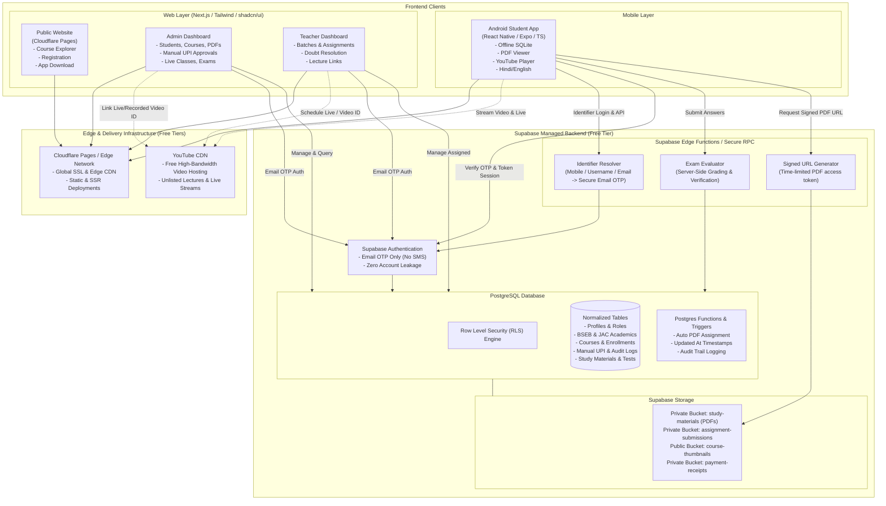
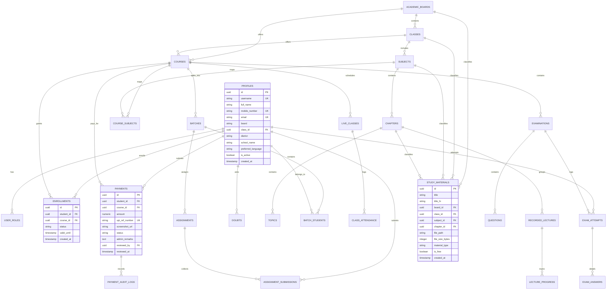

# IDEAL COACHING CENTRE — MASTER SYSTEM ARCHITECTURE

## 1. System Identity and Vision
**IDEAL COACHING CENTRE** is a single-institution digital coaching and learning management platform designed specifically for students in India targeting **Bihar Board (BSEB)** and **Jharkhand Board (JAC)** in Classes 9, 10, 11, and 12. 

The platform delivers a bilingual experience (**Hindi** as default, with full **English** support) across an Android Student Application, an Admin Web Dashboard, a Teacher Web Dashboard, a Public Coaching Website, and a Supabase backend operating under a **Strict Zero-Paid-Service Policy** (₹0/month baseline infrastructure).

---

## 2. High-Level System Architecture Diagram

---

## 3. Strict Zero-Paid-Service Architecture ($0 / Month)

| Layer | Service / Technology | Free-Tier Limits & Compliance Strategy | Monthly Cost |
| :--- | :--- | :--- | :--- |
| **Backend & DB** | Supabase Free Tier | 500 MB DB, 50k monthly active users, 1 GB file storage, 500k edge function calls. Sized for single coaching institution with efficient indexing and text metadata. | **₹0** |
| **Video Hosting & Live** | YouTube (Unlisted & Live) | Unlimited bandwidth and video storage. Zero custom streaming servers or transcoder costs. Students stream directly via official YouTube IFrame/Player. | **₹0** |
| **PDF & Document Storage** | Supabase Storage (Private) | Sized to retain high-value notes and assignments. Documents compressed before upload; signed short-lived URLs prevent unauthorized distribution. | **₹0** |
| **Authentication & OTP** | Supabase Auth Email OTP | Standard Supabase Free email delivery. **Zero SMS gateway, zero mobile OTP provider**. OTP is strictly delivered to the student's registered email address regardless of whether they log in via Mobile Number, Username, or Email. | **₹0** |
| **Web Hosting** | Cloudflare Pages Free Tier | Unlimited bandwidth, 500 builds/month, commercial use permitted under Cloudflare standard free terms. | **₹0** |
| **Mobile App Builds** | Local Android SDK & Gradle | Standard local CLI builds (`npx react-native run-android` / `gradlew assembleRelease` / `bundleRelease`). Zero dependency on paid cloud EAS builds. | **₹0** |
| **Payments** | Manual UPI QR & UTR Verification | Uses India's zero-surcharge UPI payment rails with manual screenshot & transaction ID submission, and admin approval audit flow. Zero payment gateway fees. | **₹0** |
| **Total Operating Cost** | | | **₹0 / mo** |

---

## 4. Database Entity-Relationship Model

---

## 5. Screen & Feature Inventory

### A. Android Student Application (React Native / Expo)
1. **Splash & Onboarding Screen**: Bilingual welcome, brand logo, Hindi/English toggle.
2. **Unified Login Screen**: Single identifier input ("Mobile Number / Username / Email"), rate-limited identifier resolution, OTP sent to email notice.
3. **Email OTP Verification Screen**: 6-digit OTP entry, resend cooldown timer, masked email hint (`s****@g****.com`), session establishment.
4. **Student Registration Screen**: Full Name, Username, Mobile (+91 format), Email, Board (BSEB / JAC), Class, District, Language selector.
5. **Home Dashboard**: Student greeting, active board & class banner, continue watching bar, live class banner ("LIVE NOW" with pulse indicator), enrolled courses, recent study materials, upcoming tests, daily notice.
6. **Course Catalog Screen**: Board & Class filtered course list, subject badges, pricing (Free vs ₹), discount tags, search & filter.
7. **Course Details Screen**: Syllabus tree (Subjects -> Chapters -> Lectures), sample video previews, batch schedule, "Enroll for Free" or "Pay via UPI".
8. **Manual UPI Payment Screen**: Institution UPI ID, dynamic/static QR code, total payable, UTR/Transaction Reference input, receipt screenshot upload, status tracker (Pending -> Approved).
9. **Live Classes Screen**: "Live Now", "Upcoming", and "Past Completed" tabs, YouTube Live embedded player with countdown, attendance check-in.
10. **Recorded Lectures Player Screen**: High-quality YouTube video player with speed control, chapter playlist, lecture notes download button, resume playback position.
11. **Study Materials & Notes Screen**: Hierarchical academic filter (Board -> Class -> Subject -> Chapter), PDF previewer, offline download cache, bookmarking.
12. **Online Examination Portal Screen**: Available tests, instructions & negative marking rules, start exam gate.
13. **Active Exam Test-Taking Screen**: Question palette (Answered, Unanswered, Marked for Review), bilingual toggle per question, auto-save, countdown timer, auto-submit.
14. **Exam Result & Scorecard Screen**: Marks breakdown, accuracy percentage, time taken, question-by-question explanations in Hindi & English.
15. **Assignments Screen**: Homework assignments list, download reference PDF, upload student response (PDF/Image), view teacher marks and review remarks.
16. **Doubt Clearance Screen**: Post doubt with optional photo/screenshot, select subject & chapter, view teacher answers.
17. **Profile & Settings Screen**: Edit personal details, switch Board (BSEB/JAC) or Class, change language (Hindi/English), dark/light theme, download storage cleaner, terms & privacy, logout.

### B. Admin Web Dashboard (Next.js / shadcn/ui)
1. **Analytics Overview**: Total students, active subscriptions, revenue collected via UPI, live batches, storage usage monitor.
2. **Student Directory**: Search by mobile/username/email, filter by BSEB/JAC and class, view full profile, enrollments, manual extension, block/unblock.
3. **Academic Structure Manager**: Board management (BSEB / JAC), sessions (e.g. 2026-2027), classes (9-12), subjects (Physics, Math, Chemistry, etc.), chapters, and topics with bilingual names.
4. **Course Builder**: Create/edit courses, map board & class, set price & validity days, link curriculum subjects, publish/archive.
5. **Batch Manager**: Create batches, assign teachers, schedule weekly class timings, manage student lists.
6. **Live Class Scheduler**: Create YouTube Live sessions, set start time, assign teacher and batch, publish stream link.
7. **Recorded Lecture Manager**: Organize video playlists by Chapter, insert YouTube video IDs, assign preview permissions.
8. **Automated PDF & Notes Hub**: Upload PDF files with academic metadata (Board, Class, Subject, Chapter). Automatic mapping ensures enrolled students get immediate access without individual assignment.
9. **UPI Payment Review & Approvals**: List pending payment submissions, view UTR and screenshot receipt, one-click Approve (activates enrollment) or Reject with remarks. Immutable audit log.
10. **Examination Builder**: Create MCQ, multiple-choice, and true/false questions; set marking scheme and negative marks; bilingual question editor; CSV bulk question import.
11. **Teacher Manager**: Register teachers, assign subject specializations and batches, configure permissions.
12. **Reports & Exports**: CSV exports for registrations, revenue, attendance, and exam performances.
13. **System Settings & Resource Quotas**: Coaching brand details, logo, UPI VPA & QR code, default language, Supabase free-tier quota monitor (DB size, storage size, auth users).

### C. Teacher Web Dashboard
1. **Teacher Dashboard**: Today's classes, assigned batches, pending homework submissions, unanswered student doubts.
2. **My Batches & Students**: List of students enrolled in assigned batches.
3. **Live Class Launcher**: View scheduled classes, enter stream URL, broadcast class announcements.
4. **Lecture & Study Material Uploader**: Add recorded lecture links and upload lecture notes for assigned subjects.
5. **Assignment Evaluator**: Review student PDF submissions, input marks, add feedback notes.
6. **Doubt Resolution Center**: Reply to student questions with explanations.

### D. Public Website (Next.js / SSR & Static)
1. **Landing Page**: Institution branding, hero banner, BSEB & JAC special features, toppers list, student testimonials, Android App download CTA.
2. **About Us**: Institution history, faculty profile, mission for Bihar & Jharkhand state board excellence.
3. **Courses & Fee Structure**: Public catalog with details on BSEB & JAC curriculum, validity, and nominal fees.
4. **Course Detail Page**: Complete syllabus outline, faculty info, fee info, "Enroll Now" redirection to registration.
5. **Faculty / Teachers Page**: Teacher bios, subjects taught, and experience.
6. **Student Registration Page**: Direct registration into the system.
7. **Download Android App Page**: Direct APK download button and installation instructions.
8. **Contact & Offline Centers**: Map, address in Bihar/Jharkhand, official email, optional WhatsApp contact link.
9. **Legal Pages**: Terms and Conditions, Privacy Policy, Refund Policy.

---

## 6. Security Architecture & Threat Mitigation

1. **Email OTP Authentication & Zero Email Leakage**:
   - The client enters an identifier (Mobile, Username, or Email).
   - An internal secure RPC function (`request_otp_by_identifier`) normalizes the input, locates the account, and triggers Supabase Auth Email OTP generation directly on the server.
   - The RPC function **never returns the email address** to unauthenticated callers. It returns only a constant generic response:
     `{"success": true, "message": "If the account exists, an OTP has been sent to the registered email address."}`.
   - Brute-force protection: Rate limit of 3 requests per 10 minutes per IP/identifier stored in `otp_rate_limits`.

2. **Row-Level Security (RLS)**:
   - Every single table in PostgreSQL has RLS enabled (`ALTER TABLE ... ENABLE ROW LEVEL SECURITY`).
   - Students can only view their own profile, their own enrollments, their own payments, and study materials matching their active enrollments.
   - Teachers can only view batches and submissions assigned to them.
   - Only users with role `admin` or `super_admin` in `user_roles` can approve payments, create courses, or view analytics.

3. **Automatic PDF Access Security**:
   - Study material PDFs are stored in a **Private Supabase Storage Bucket** (`study-materials`).
   - The direct URL is never public.
   - Students request access via an authorized endpoint or Supabase signed URL generation function.
   - The backend verifies:
     `EXISTS (SELECT 1 FROM enrollments e JOIN courses c ON e.course_id = c.id WHERE e.student_id = auth.uid() AND e.status = 'active' AND e.valid_until >= now() AND c.board_id = study_materials.board_id AND c.class_id = study_materials.class_id) OR study_materials.is_free = true`.
   - Returns a temporary signed URL valid for 15 minutes.

4. **Server-Side Exam Evaluation**:
   - Answers submitted by students are graded exclusively on the backend (`submit-exam` edge function or postgres procedure).
   - Correct answers are **never delivered to the client during an active test**.
   - Result calculation and negative marking are executed within a database transaction to prevent tampering.

5. **Manual Payment Verification Audit Trail**:
   - Payment status cannot be altered directly by students or teachers.
   - Only authenticated administrators can change status from `pending` to `approved` or `rejected`.
   - On approval, a PostgreSQL trigger or transactional function automatically creates/activates the `enrollments` row and writes to `payment_audit_logs` with the admin's `user_id`, timestamp, and previous/new status.

---

## 7. Development Roadmap

- **Phase 1**: Workspace Inspection, System Architecture, ER Design, and Monorepo Scaffolding.
- **Phase 2**: Supabase Database Schema, Migrations, RLS Policies, Secure Auth Functions, Seed Data.
- **Phase 3**: Shared TypeScript Packages (`shared-types`, `shared-validation`, `shared-utils`, `design-tokens`).
- **Phase 4**: Admin Web Dashboard (Next.js) - Complete management modules.
- **Phase 5**: Android Student Application (Expo/React Native) - Full mobile EdTech client.
- **Phase 6**: Teacher Web Dashboard - Batches, doubt resolution, assignment grading.
- **Phase 7**: Public Coaching Website - SEO-optimized, bilingual, app download links.
- **Phase 8**: End-to-end Verification, Security Testing, Role Checks, and Build Automation.
- **Phase 9**: Deployment Setup & Production Documentation.
