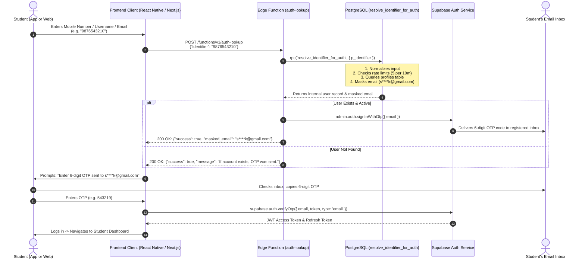

# IDEAL COACHING CENTRE — AUTHENTICATION SPECIFICATION

## 1. Zero-SMS & Email OTP Mandate
In strict compliance with the **Strict Zero-Paid-Service Policy**, IDEAL COACHING CENTRE does not use SMS gateways or mobile OTP services. 

- **OTP Delivery**: Strictly sent **ONLY** to the student's registered email address.
- **Mobile Numbers & Usernames**: Act as login identifiers only; they are **never** OTP delivery channels.
- **Passwords**: Not mandatory for the normal student login flow. Authentication is passwordless via secure 6-digit Email OTP.

---

## 2. Authentication Flow Diagram

---

## 3. Account Enumeration & Leaking Defense
To protect student privacy:
1. Unauthenticated clients **cannot** query the `profiles` table directly (protected by RLS).
2. The `resolve_identifier_for_auth` PostgreSQL function is marked `SECURITY DEFINER` and its execution is revoked from public users, only granted to `service_role`.
3. If an unrecognized identifier is entered, the response is structurally identical to a recognized one, returning a generic success message without leaking account existence.
4. If a recognized identifier is found, only a **masked email** (e.g. `r****a@gmail.com`) is provided to help the student know which inbox to check, preventing leakage of private contact details.

---

## 4. Rate Limiting Policy
- Maximum **5 OTP requests** per 10-minute window per identifier.
- Tracked internally in the `otp_rate_limits` table.
- Violators receive an explicit bilingual cooldown notice:
  *"कृपया 10 मिनट प्रतीक्षा करें। बहुत अधिक अनुरोध किए गए हैं। (Too many attempts. Please wait 10 minutes.)"*
